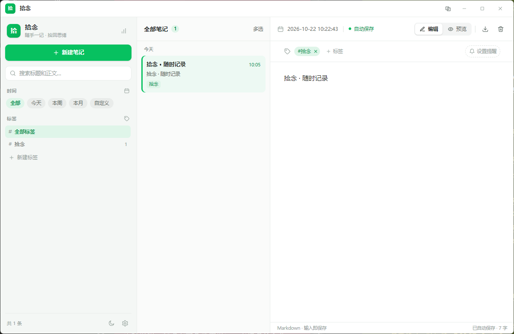
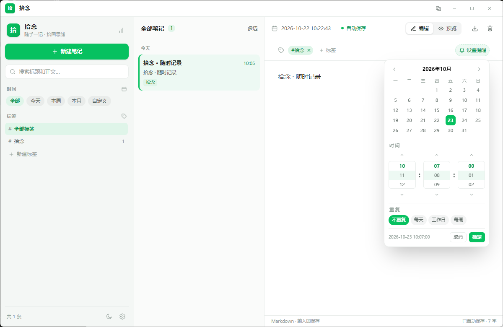
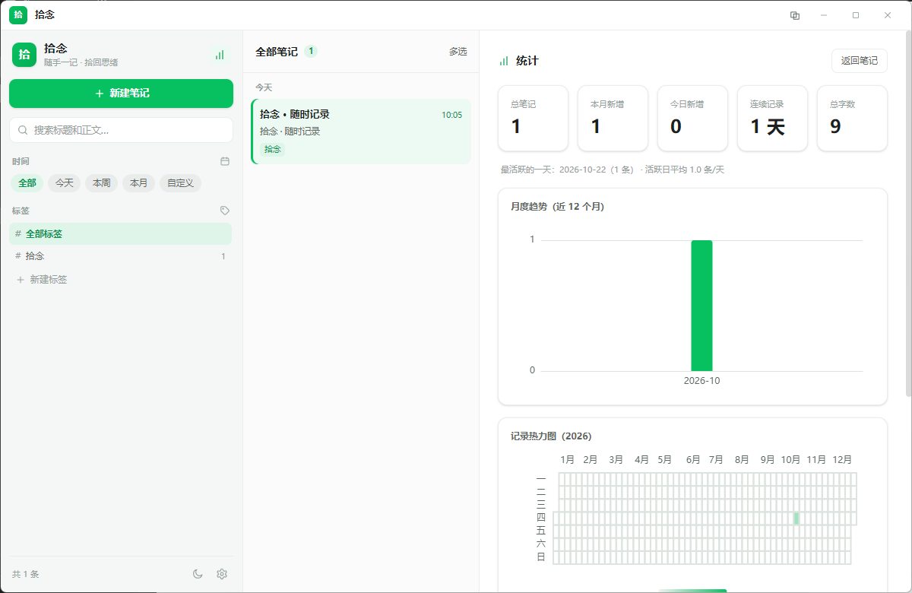
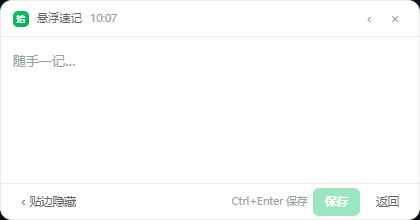

<div align="center">
  

  <h1>拾念</h1>

  <p><b>随手记录，重要的事有人提醒。</b></p>
  <p>轻量、离线、隐私优先的 Windows 桌面笔记应用</p>

  <p>
    
    
    
    
  </p>

  <p>
    <a href="https://gitee.com/jares/shinian-note/releases">
      
    </a>
  </p>
</div>

---

## 这是什么

拾念是一个**本地优先**的桌面笔记工具：打开就能写，不用登录、不联网、不上传。

它不追求做「第二个 Notion」，只把三件事做顺：**随手记下来**、**找得回**、**到点提醒你**。

- 没有账号，没有同步，没有订阅
- 数据是本地一个 SQLite 文件，备份就是复制它
- 常驻托盘，`Ctrl + Shift + N` 随时唤出悬浮速记窗

## 截图

| 主界面（三栏布局） | 编辑与提醒 |
| --- | --- |
|  |  |

| 统计视图 | 悬浮速记窗 |
| --- | --- |
|  |  |

> 截图占位文件位于 `docs/screenshots/`，替换为实拍截图即可（建议 1200×780，PNG）。

## 下载安装

前往 [发行版页面](https://gitee.com/jares/shinian-note/releases) 下载最新版本，提供两种包：

| 文件 | 说明 | 适合 |
| --- | --- | --- |
| `拾念-Setup-1.0.0.exe` | NSIS 安装包，创建开始菜单与桌面快捷方式 | 长期使用 |
| `拾念-Portable-1.0.0.exe` | 免安装便携版，双击即用 | 试用、放 U 盘 |

首次运行 Windows 可能提示「未知发布者」，点 **更多信息 → 仍要运行** 即可（个人项目未购买代码签名证书）。

系统要求：Windows 10 / 11（64 位）。

## 功能

| 模块 | 能力 |
| --- | --- |
| 笔记 | 新建 / 编辑 / 删除，400ms 防抖自动保存；Markdown 编辑与预览切换 |
| 组织 | 标签分类、按天分组、全文搜索；列表项悬停「⋯」可直接设置提醒 / 导出 / 删除 |
| 提醒 | 到点弹窗提醒、多条合并、点击跳转原文；支持**每天 / 工作日 / 每周指定星期**重复，触发后自动排下一次 |
| 时间 | 今天 / 本周 / 本月 / 自定义区间筛选，全部为自绘日期与时间控件（滚轮选时分秒） |
| 速记 | 全局快捷键唤出悬浮窗，`Ctrl + Enter` 保存、`Esc` 收起；贴边后收成小圆球，鼠标靠近自动展开 |
| 统计 | 总数 / 今日 / 本月、近 12 个月趋势、年度热力图、标签 TOP、连续记录天数 |
| 外观 | 浅色 / 深色 / 跟随系统，微信绿 / 琥珀黄 / 蓝三套主题色，分栏宽度可拖动并记忆 |
| 数据 | 本地 SQLite（WAL）、一键备份 / 恢复、整库导出 Markdown、粘贴图片本地存储 |
| 系统 | 托盘常驻、关闭到托盘、窗口位置记忆、单实例锁 |

## 数据与隐私

所有内容只存在你自己的电脑上，应用不会发起任何网络请求（导出、备份都是本地文件操作）。

| 内容 | 位置 |
| --- | --- |
| 数据库 | `%APPDATA%\拾念\shinian.db` |
| 图片 | `%APPDATA%\拾念\images\` |
| 窗口状态 | `%APPDATA%\拾念\window-state.json` |

备份建议：设置面板里的「备份」会另存一份数据库副本；也可以直接复制上面的 `shinian.db`。卸载应用不会删除这些数据。

## 快速上手

1. 打开应用，点左上角「新建」或按 `Ctrl + N` 开始写
2. 选中段落用标签归类，左侧标签栏可筛选
3. 需要提醒时，点编辑器里的「提醒」，选日期与重复规则
4. 想随手记一句：`Ctrl + Shift + N` 唤出速记窗，写完 `Ctrl + Enter`

## 从源码运行

环境：Node.js 18+（建议 20+）、pnpm（推荐）或 npm。

```bash
pnpm install      # 安装依赖
pnpm dev          # 开发模式（热更新）
pnpm build        # 仅构建
pnpm dist         # 打包安装版 + 便携版，输出到 release/
pnpm dist:portable
pnpm dist:dir     # 只解包目录，调试用
```

国内网络打包前建议设置镜像，避免下载 Electron / NSIS 超时：

```powershell
$env:ELECTRON_MIRROR="https://npmmirror.com/mirrors/electron/"
$env:ELECTRON_BUILDER_BINARIES_MIRROR="https://npmmirror.com/mirrors/electron-builder-binaries/"
```

若 `better-sqlite3` 在 Electron 中加载失败，重新编译原生模块：

```bash
pnpm rebuild
```

已知依赖约束：`@electron/rebuild` 需固定为 `3.6.1`，与 `electron-builder 25.x` 不兼容 4.x。

## 技术栈

- **壳**：Electron 31
- **构建**：electron-vite 2 + Vite 5
- **界面**：Vue 3（`<script setup>`）+ Tailwind CSS 4
- **数据**：better-sqlite3（WAL 模式）
- **图表**：ECharts 6
- **Markdown**：marked
- **打包**：electron-builder 25（NSIS + Portable）
- **安全**：`contextIsolation` + preload 白名单 IPC

## 目录结构

```
shinian-note/
├── assets/                  # 应用图标
├── docs/screenshots/        # README 截图
├── src/
│   ├── main/                # 主进程：窗口 / 托盘 / 快捷键 / 提醒调度
│   │   ├── index.js
│   │   ├── db.js            # SQLite 数据层
│   │   └── ipc.js           # IPC 白名单
│   ├── preload/             # contextBridge 桥接
│   └── renderer/            # 渲染层
│       ├── index.html       # 主窗口
│       ├── quick.html       # 速记窗
│       ├── float.html       # 悬浮速记窗
│       ├── reminder.html    # 提醒弹窗
│       └── src/
│           ├── App.vue      # 三栏主界面
│           ├── components/  # NoteList / NoteEditor / 自绘日期控件 等
│           ├── theme.js     # 主题切换
│           └── ui.js        # 应用内弹层 / Toast
├── electron-builder.yml     # 打包配置
└── electron.vite.config.js
```

## 设计理念

- **本地优先**：不做云端依赖，数据始终在用户手里
- **层级清晰**：高频操作（新建、搜索）放一级界面，低频（导出、备份、恢复）收进设置面板
- **克制的配色**：默认微信绿，只在关键操作点用主色，避免大面积铺色
- **应用内反馈**：确认框、日期控件全部自绘，不用系统原生弹窗

## 路线图

- [ ] Markdown 语法快捷插入（表格、代码块）
- [ ] 笔记置顶与收藏
- [ ] 更细的全文搜索（正则 / 标签组合）
- [ ] macOS / Linux 构建
- [ ] 主题色自定义

## 反馈

使用中遇到问题或有想法，欢迎在 [Issues](https://gitee.com/jares/shinian-note/issues) 提出，附上系统版本与复现步骤会更容易定位。

如果这个项目对你有帮助，点个 Star 支持一下。

## 许可证

[MIT](LICENSE) © 2026 jares chiang
